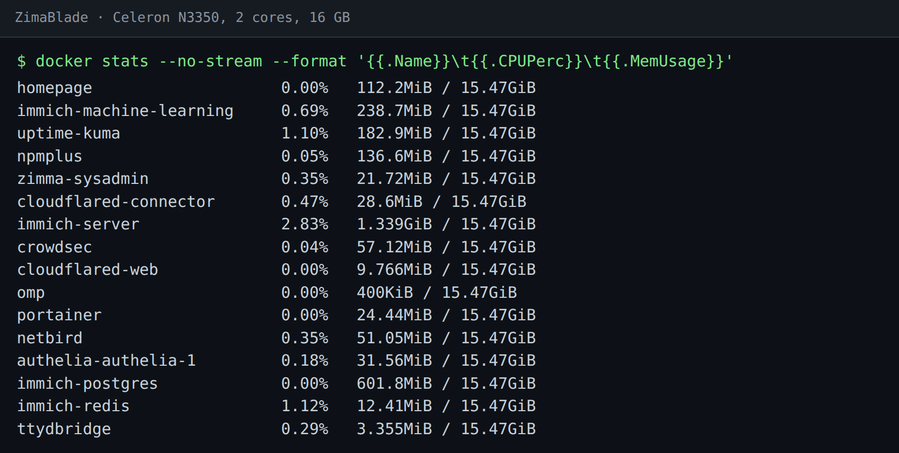

# 04 · Uptime Kuma on the Zima, and why the slim image

**Upgrading Uptime Kuma to the latest tag didn't remove the actively exploited Chromium bugs inside it. Switching to the `-slim` image did, and it's a third of the size.**

Uptime Kuma is a good fit for a ZimaBlade: one container, a SQLite file, and it sat at about 183 MiB of memory on
mine (below). This recipe runs it as a plain container so CasaOS can't remove it ([recipe 03](03-apps-casaos-cant-eat.md)),
picks the image that doesn't ship a browser you aren't using, and covers the one thing a monitor on the Zima can't
do: notice the Zima itself going down.



---

## Run it

```bash
docker run -d --name uptime-kuma --restart unless-stopped -p 3001:3001 \
  -v /DATA/AppData/kuma:/app/data \
  louislam/uptime-kuma:2.5.6-slim
```

Open `http://<zima>:3001` and make the admin account. Pin a real version tag rather than `latest`, so an upgrade only
happens when you decide.

---

## Why `-slim`

A vulnerability scan of the full `2.4.0` image found Debian's Chromium 148 inside it, with three CVEs on CISA's
known-exploited list (CVE-2026-11645, CVE-2026-85046, CVE-2026-87491). Uptime Kuma bundles Chromium for one monitor
type, **Real Browser**, which loads a page in a headless browser.

The obvious fix doesn't work. The full `2.5.6` image **still ships Chromium 148**: a newer tag of the app is not a
newer browser. The `-slim` variant leaves Chromium out (and the embedded MariaDB, which you don't need with SQLite).

Measured on this Zima:

| | `2.4.0` (full) | `2.5.6-slim` |
|---|---|---|
| image size | 1.71 GB | 540 MB |
| known-exploited CVEs in the scan | 3, all in Chromium | 0 |

### Check you can use it

`-slim` can't run Real Browser monitors. Before switching, count your monitors by type. The `-slim` image still has
`sqlite3`, and `-readonly` means this can't change anything:

```bash
docker exec uptime-kuma sqlite3 -readonly /app/data/kuma.db \
  "select type, count(*) from monitor group by type;"
```

```
http|19
keyword|2
ping|7
port|7
push|6
```

No `real-browser` line, so nothing here needs Chromium. Every monitor stayed up after the switch (33 of 33 at the
time), ping monitors included. If you do have Real Browser monitors, stay on the full image and watch for a release that updates its
Chromium.

---

## Upgrading without a way back is a gamble, so keep one

```bash
docker stop uptime-kuma
docker rename uptime-kuma uptime-kuma-old
docker update --restart no uptime-kuma-old
# copy the data while Kuma is stopped, so the SQLite file is consistent
docker run --rm -v /DATA/AppData/kuma:/data:ro -v /media/ZM-Data:/out alpine \
  tar -czf /out/kuma-data-$(date +%Y%m%d).tgz -C /data .
docker run -d --name uptime-kuma --restart unless-stopped -p 3001:3001 \
  -v /DATA/AppData/kuma:/app/data louislam/uptime-kuma:2.5.6-slim
```

Copy the data with Kuma stopped. A copy of a SQLite file taken while it's being written can be unusable, and you'd
only find out when you need it.

If the new one misbehaves: stop it, start `uptime-kuma-old`, and restore the tarball if the data was changed. Once
it's been fine for a week, `docker rm uptime-kuma-old` and `docker image rm louislam/uptime-kuma:2.4.0` to get the
1.7 GB back.

Put the tarball on the array (`/media/ZM-Data` here), not `/DATA`. On this machine `/DATA` is 17 GB of eMMC with
4.7 GB free; see [recipe 05](05-disk-pressure-and-a-coldstore.md).

---

## The blind spot: Kuma can't see its own host die

When the Zima goes down, so does the thing meant to tell you. Uptime Kuma can't page you about its own outage.

Something on another always-on machine has to check Kuma. Mine is a small script on a separate server, every 5
minutes:

1. try to sign in to Kuma's web UI
2. if that fails, SSH to the Zima and start (or restart) the `uptime-kuma` container
3. post to chat saying what it found and what it did

A plain HTTP check from a second machine (even a second Uptime Kuma, or a free external uptime service against a
public status page) gets you most of the way. The point is that it doesn't run on the box it's watching.

Two rules worth copying, whatever you use:

- **Unreachable isn't dead.** One failed check during a reboot or a busy minute isn't an outage. Act on two in a row.
- **Alert once per change.** "Kuma down" and then "Kuma back", not a message every 5 minutes.

---

*Verified on a ZimaBlade running ZimaOS: image sizes, the monitor counts and the running tag were read off the
machine on 11 October 2026; the Chromium and KEV findings come from the scans before and after the switch on
10 October 2026.*

Back to the [recipe index](../README.md) · previous: [03 · Apps CasaOS can't eat](03-apps-casaos-cant-eat.md) · next: [05 · Disk pressure and a coldstore](05-disk-pressure-and-a-coldstore.md)
