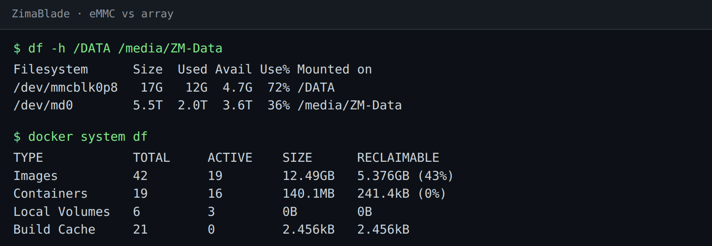

# 05 · Disk pressure, and a coldstore on the Zima

**When my other servers ran low on disk, I nearly moved their data to the Zima. It wouldn't have freed anything: the space was Docker images, and those can't live on a network share.**

This recipe is two things. First, how to find out what's actually filling a disk before you move anything, on the
Zima and elsewhere. Second, what the Zima *is* good for: a "coldstore" share on its big array, for old logs and
archives from other machines, set up so a Zima outage can never stop them booting.

---

## Know your two disks

A ZimaBlade has a small built-in eMMC and whatever you've attached. ZimaOS puts `/DATA`, and with it `AppData`, on
the eMMC:



On this machine `/DATA` is 17 GB with 4.7 GB free, and the array is 5.5 TB with 3.6 TB free. Anything big belongs on
the array. Check where Docker keeps its images:

```bash
docker info --format '{{.DockerRootDir}}'
```

```
/media/ZM-Data/docker
```

Here it's on the array, which is what you want: 12.49 GB of images would be most of the eMMC. If yours says
`/DATA/...`, that's your disk pressure, and images are the first thing to deal with.

## Measure before you move anything

`docker system df` splits Docker's usage into images, containers, volumes and build cache, with what's reclaimable:

```bash
docker system df
```

On the Zima, 5.4 GB of the 12.5 GB of images is reclaimable: old tags kept as rollbacks after upgrades
([recipe 04](04-uptime-kuma-on-the-zima.md) leaves one on purpose). `docker image prune` removes dangling images;
remove old tags by name once you're sure you won't roll back.

The same check on my Proxmox containers is what stopped me moving their data to the Zima. Four of them were 82–86%
full, and none of it was data:

| container | what was filling it |
|---|---|
| Docker host | 16 GB of images |
| 3D-printer monitor | 11.4 GB of images and 11.3 GB of build cache |
| Home Assistant host | 7.3 GB of images |
| uptime monitor | the operating system itself, on a 3.9 GB disk |

You can't put a running container's image layers on NFS (overlayfs on top of NFS is slow and fragile), so a share on
the Zima would have fixed none of those. The fix was giving them more local disk: the Proxmox storage pools were
under 8% used.

## What the Zima *is* good for: a coldstore

Cold data is the stuff you keep but rarely read: rotated logs, archives of things you've switched off, exports. That
suits the array well, over NFS.

**Use its own folder.** If the Zima already holds backups from another system with a retention policy (Proxmox's
`prune-backups`, for example), don't put anything else in that folder: the policy owns it and will delete what it
doesn't recognise. Make a separate one on the array, never under `/DATA`:

```bash
# as root on the Zima: see recipe 00
mkdir -p /media/ZM-Data/coldstore
```

**Export it to the machines that use it, and nothing else.** `/etc/exports` is root-owned, so this needs the root
trick from [recipe 00](00-borrowing-root-from-docker.md) too. The line, with documentation addresses standing in for
the two servers allowed to mount it:

```
/media/ZM-Data/coldstore 192.0.2.20(rw,sync,no_subtree_check,no_root_squash) 192.0.2.10(rw,sync,no_subtree_check,no_root_squash)
```

Then reload the export table and check it:

```bash
exportfs -ra
showmount -e localhost
```

`no_root_squash` lets root on those two machines write as root (the archiving job below runs as root). That's a lot
of trust, which is why the export names two addresses and not a whole subnet.

**Mount it so an outage can't block a boot.** On each client, one `/etc/fstab` line:

```
192.0.2.149:/media/ZM-Data/coldstore /mnt/zima-coldstore nfs4 rw,vers=4.2,_netdev,nofail,x-systemd.automount,x-systemd.idle-timeout=600 0 0
```

- `nofail`: if the Zima is down at boot, the client boots anyway.
- `x-systemd.automount`: it's only mounted when something touches `/mnt/zima-coldstore`.
- `x-systemd.idle-timeout=600`: and unmounted again after 10 idle minutes.

Without `nofail`, a Zima reboot at the wrong moment leaves a server waiting at boot for a share that isn't there.

## Moving data into it safely

My weekly job archives rotated logs older than 7 days out of each container into
`/mnt/zima-coldstore/<server>/<container>/`. Three rules make it safe to leave running:

1. **Refuse to run unless the share is mounted.** Check `mountpoint -q /mnt/zima-coldstore` first. Otherwise a Zima
   outage means the job writes "to the Zima" straight into the server's own root disk, the one you were trying to
   free.
2. **Archive, verify, then delete.** `tar -czf`, then `tar -tzf` to prove the archive reads back, and only then delete
   the originals. A failed or corrupt archive leaves the source untouched and gets logged.
3. **Log what it freed.** You want the number.

The number is the lesson. The first run reclaimed **213 MB** across both servers, and last Sunday's reclaimed 210 KB.
There was hardly any cold data, which confirmed the diagnosis above: the disks were full of images, not data. The
coldstore earns its place anyway, as somewhere to put the export of a service before you switch it off.

---

*Verified on a ZimaBlade running ZimaOS and the two Proxmox servers that mount its coldstore: `df`, `docker system df`,
the Docker root, `/etc/exports`, the client `fstab` line and the job's log were read off the machines on
11 October 2026. The 82–86% table is from the August 2026 investigation.*

Back to the [recipe index](../README.md) · previous: [04 · Uptime Kuma on the Zima](04-uptime-kuma-on-the-zima.md)
